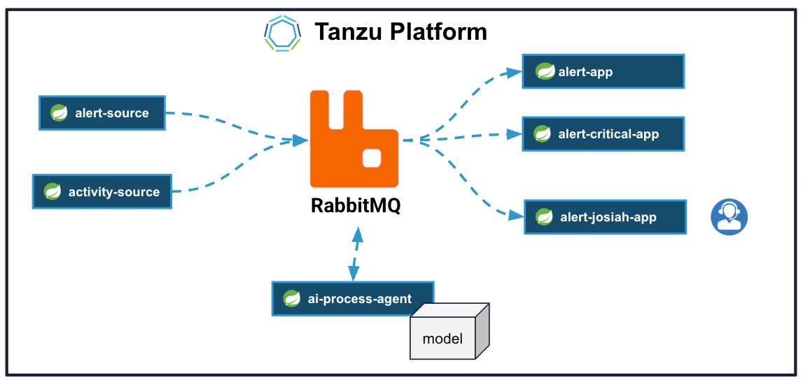

# Tanzu Platform RabbitMQ Event Streaming Demo





Perquisites

```shell
./deployment/cloud/cloudFoundry/scripts/delete-queues.sh
```
Expected No new alerts or activities in running applications.

```shell
cf restart alert-app
cf restart alert-critical
cf restart alert-josiah
cf restart alert-source
cf restart alert-ai-processor
cf restart activity-source
```

## 1. Open RabbitMQ Management Dashboard

```shell
cf create-service-key rabbitmq rabbit-key -c '{"tags": "administrator"}'
cf service-key rabbitmq rabbit-key
```
Let's start out by opening up the RabbitMQ to management console.

```shell
export RABBIT_USERNAME=$(cf service-key rabbitmq rabbit-key | tail -n +3 | jq -r '.credentials.username')
export RABBIT_PASSWORD=$(cf service-key rabbitmq rabbit-key | tail -n +3 | jq -r '.credentials.password')
export RABBIT_VHOST=$(cf service-key rabbitmq rabbit-key | tail -n +3 | jq -r '.credentials.vhost')
export RABBIT_URL=$(cf service-key rabbitmq rabbit-key | tail -n +3 | jq -r '.credentials.dashboard_url')
echo "RabbitMQ User $RABBIT_USERNAME , Password:$RABBIT_PASSWORD vhost: $RABBIT_VHOST"
open $RABBIT_URL
```

The console allows us to monitor and update RabbitMQ. You can get insights into the health of a cluster and performance operations using a user friend web interface.


This particular cluster of the RabbitMQ nodes instance is deployed on Tanzu platform. 
Tanzu Platform has a Tile that simplifies provisioning and management  RabbitMQ.

It is like have a RabbitMQ subject matter expert to manage RabbitMQ deployment.

----------------

## 2. Open Activities & Alert Security Monitor App 

There is a consumer application that displays all of alerts and activities that have been published to RabbitMQ.

```shell
ALERT_ALL_URL=`cf apps | awk '$1 == "alert-app" {print $NF}'`
echo opening $ALERT_ALL_URL

open https://$ALERT_ALL_URL
```

Another instance of this app handles only critical, high-risk security alerts for a specific user. This setup is ideal for sensitive, time-critical events, allowing RabbitMQ to filter out non-critical alerts before they reach the application.


```shell
ALERT_CRITICAL_URL=`cf apps | awk '$1 == "alert-critical" {print $NF}'`
echo opening $ALERT_CRITICAL_URL

open https://$ALERT_CRITICAL_URL
```


## 4. Post critical alerts

A source application publishes alerts to RabbitMQ.

```shell
ALERT_SOURCE_URL=`cf apps | awk '$1 == "alert-source" {print $NF}'`
echo opening $ALERT_SOURCE_URL

open https://$ALERT_SOURCE_URL
```

In this case I will publish alerts with various severity. 


## 5. Open All & Only Critical Alerts


This app instance displays all published the alerts.

```shell
ALERT_ALL_URL=`cf apps | awk '$1 == "alert-app" {print $NF}'`
echo opening $ALERT_ALL_URL

open https://$ALERT_ALL_URL
```

This instance of the application only consumes critical alerts for the given user.

```shell
ALERT_CRITICAL_URL=`cf apps | awk '$1 == "alert-critical" {print $NF}'`
echo opening $ALERT_CRITICAL_URL

open https://$ALERT_CRITICAL_URL
```


## 6.  Publish Activity

There is a source application publishes activities to RabbitMQ.

```shell
ACTIVITY_URL_SOURCE=`cf apps | awk '$1 == "activity-source" {print $NF}'`
echo opening $ACTIVITY_URL_SOURCE
open http://$ACTIVITY_URL_SOURCE
```

I will sent various activities


## 7. Open All & User Based Activities

This app instance displays all published  activities.

```shell
ALERT_ALL_URL=`cf apps | awk '$1 == "alert-app" {print $NF}'`
echo opening $ALERT_ALL_URL

open https://$ALERT_ALL_URL
```

This instance of the application only consumes activities for the given user.

```shell
ALERT_CRITICAL_URL=`cf apps | awk '$1 == "alert-critical" {print $NF}'`
echo opening $ALERT_CRITICAL_URL

open https://$ALERT_CRITICAL_URL
```

------------------


## 8. Open AI Agent Processor

There is an AI processor app that consumes activities from RabbitMQ. It analyzes batching of stream using an AI models to determine realtime fraud alerts. 

```shell
ALERT_AI_PROCESSOR_URL=`cf apps | awk '$1 == "alert-ai-processor" {print $NF}'`
echo opening $ALERT_AI_PROCESSOR_URL
open https://$ALERT_AI_PROCESSOR_URL
```

This use case highlights the benefits of using messaging systems. You can inject intermediate steps into data pipelines to implement new and inventive requirements as needed.


I will introduce Fraudulent Activities in the Source application for a particular user.

```shell
ACTIVITY_URL_SOURCE=`cf apps | awk '$1 == "activity-source" {print $NF}'`
echo opening $ACTIVITY_URL_SOURCE
open http://$ACTIVITY_URL_SOURCE
```


## 9. Start Josiah Alert App


This instance of the application only consumes alerts for another user.

```shell
ALERT_JOSIAH_URL_SINK=`cf apps | awk '$1 == "alert-josiah" {print $NF}'`
echo opening $ALERT_JOSIAH_URL_SINK 
open https://$ALERT_JOSIAH_URL_SINK
```

Example use can represent advanced services for premium users or personalize fraud monitoring for specific users.

## 10.  Generator Activities

Start Generator to demo existing applications do not get generated
alerts and activities because of the RabbitMQ filtering.

Reviews stats in RabbitMQ console

```shell
cf start generator-supplier-source
```


DO NOT FORGET TO STOP Generator

```shell
cf stop generator-supplier-source
```


-------------------


## 7.  Restart Apps for Data as Service

These applications store all alerts and activities and memory. For typical applications this day that will be lost when you restart the application. Rabbit streams allows RabbitMQ to be used as a data source. In this case applications can reread the data  from RabbitMQ after a restart.


```shell
cf stop alert-app
cf start alert-app
cf stop alert-critical
cf start alert-critical
```

Review Logs